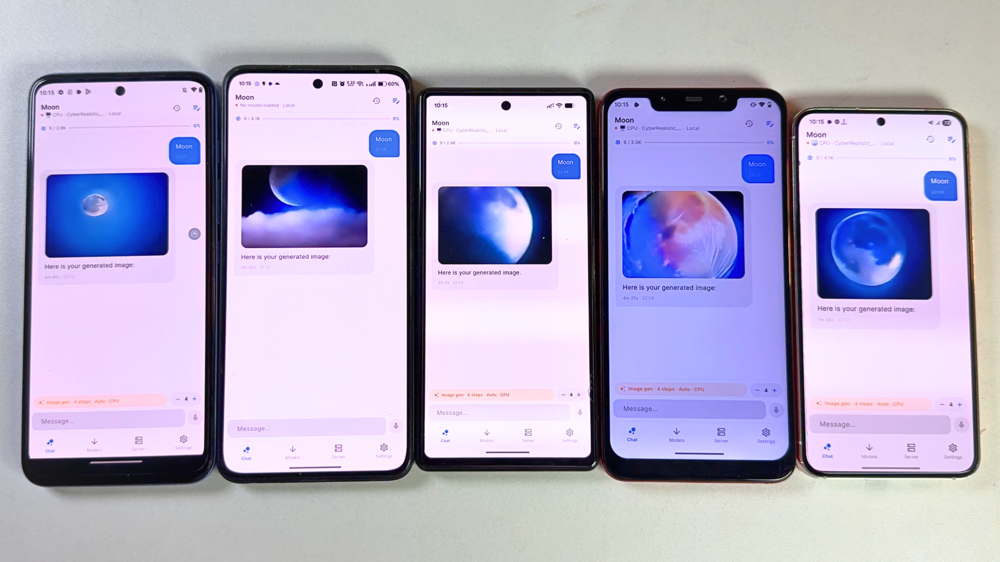
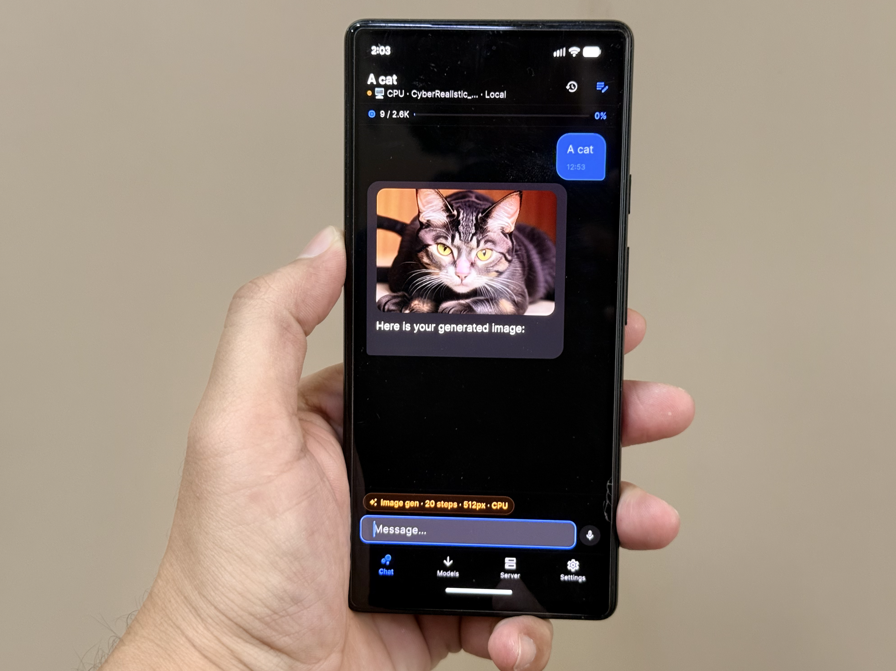

# PrivateLM-Mesh

> **Distributed Heterogeneous LLM Inference Cluster & Client**  
> *Forked from the original [PrivateLM by orailnoor](https://github.com/orailnoor/cross-platform-llm-client)*

PrivateLM-Mesh unifies local on-device LLM inference across **Windows PC, Apple Silicon Mac, Linux, Android, and iOS** into a collaborative compute cluster. By pooling system RAM and GPU VRAM over your local network (LAN / Wi-Fi), you can run large open-weights models (such as Llama 3 70B, Qwen 2.5, DeepSeek) that would otherwise never fit on a single phone or laptop.

---

## What PrivateLM-Mesh Adds

- 🖥️ **Desktop Clients for PC, Mac, and Linux** — Native Flutter desktop clients with multi-window, keyboard-driven UI, and deep hardware acceleration.
- ⚡ **Heterogeneous GPU & RAM Pooling** — Connect an NVIDIA RTX PC (CUDA), an M-series Mac (Metal), and an Android phone (Vulkan/NEON) to divide transformer layers seamlessly across machines using `llama.cpp`'s `ggml-rpc`.
- 🦀 **Ultra-Lightweight Rust Cluster Daemon (`privatelm-mesh-daemon`)** — Run headless background worker daemons on dedicated machines or home servers with `< 10 MB` RAM footprint.
- 📡 **Zero-Config LAN Discovery** — Automatically discover peers and workers via mDNS / DNS-SD (`_privatelm._tcp`).
- 📊 **Dynamic Latency-Aware Layer Placement** — Automatically benchmarks memory bandwidth (GB/s) and network RTT to distribute model weights without bottlenecking generation speed.
- 🛡️ **100% Private & Offline** — Only the coordinator requires the GGUF model file on disk; model weights are streamed directly to workers over encrypted or private local TCP sockets. No telemetry leaves your local network.


_Image generation tested on Moto G71 (Snapdragon), Oneplus 10r (Mediatek), Pixel 6A (Tensor), Poco F1 (Snapdragon), Samsung s23 (Snapdragon) 4 steps fast_


_Generated on pixel 6 with 20 step_

---

## What It Does

- **Local Inference on Android** — Download and run GGUF models directly on your phone using GPU-accelerated inference (Vulkan). No internet required after download.
- **Cloud API Fallback** — Seamlessly switch to OpenAI, Anthropic, Google Gemini, or Kimi (Moonshot AI) when you need more power or are on unsupported platforms.
- **Multimodal Chat** — Send text and images in conversations. Vision support works with both local models (Qwen2-VL) and cloud providers.
- **Persistent Sessions** — All chats and settings are stored locally via Hive. Nothing leaves your device unless you explicitly choose cloud mode.
- **Background Services** — Firebase Cloud Messaging integration for push updates and background task handling.
- **Smart Auto-Configuration** — On first launch, the app detects your device's RAM and recommends optimal context size and token limits automatically.
- **Task Management (in development)** — A task view for structured, multi-step AI workflows is being built. It is not available in the app yet.

---

## Technical Architecture

### Stack

- **Framework:** Flutter 3.x (Dart >=3.3.0)
- **State Management:** GetX
- **Local Storage:** Hive
- **Networking:** Dio + `package:http`
- **Background Execution:** `flutter_background_service` + `flutter_local_notifications`
- **Push Notifications:** Firebase Core + Firebase Messaging

### Inference Pipeline

```
┌─────────────────────────────────────────────────────────────┐
│                        UI Layer                              │
│   ChatView / ModelView / ServerView / SettingsView          │
└──────────────────────────┬──────────────────────────────────┘
                           │
┌──────────────────────────▼──────────────────────────────────┐
│                    Controllers (GetX)                        │
│   ChatController · TaskController · ModelController         │
│   SettingsController · HomeController                       │
└──────────────────────────┬──────────────────────────────────┘
                           │
┌──────────────────────────▼──────────────────────────────────┐
│                      Services                                │
│  ┌─────────────────┐  ┌─────────────────┐  ┌─────────────┐ │
│  │ InferenceService│  │  CloudService   │  │DownloadSvc  │ │
│  │  (local GGUF)   │  │ (OpenAI/Claude/ │  │ (model dl)  │ │
│  │                 │  │  Gemini/Kimi)   │  │             │ │
│  └─────────────────┘  └─────────────────┘  └─────────────┘ │
│  ┌─────────────────┐  ┌─────────────────┐  ┌─────────────┐ │
│  │  HiveService    │  │ DeviceInfoSvc   │  │ExecutionSvc │ │
│  │  ( persistence) │  │  (RAM/GPU tier) │  │ (bg tasks)  │ │
│  └─────────────────┘  └─────────────────┘  └─────────────┘ │
└─────────────────────────────────────────────────────────────┘
```

### Local Inference (Android)

The app uses `llama_flutter_android`, a custom Flutter plugin wrapping `llama.cpp` for ARM64 devices. At runtime it:

1. **Detects GPU capabilities** via Vulkan to determine offload layers.
2. **Selects thread count** based on device tier (ultra / high / mid / low).
3. **Loads the GGUF model** with progress streaming.
4. **Generates tokens** via `generateChat()` with native chat-template support (ChatML, Llama-3, Gemma, Phi).
5. **Falls back** to manual prompt construction if native templates fail.

Idle detection (5s) and hard timeouts (180s) keep the UX responsive even on underpowered hardware.

### Cloud Inference

`CloudService` normalizes four different API shapes into a single interface:

- **OpenAI** — standard `/v1/chat/completions`
- **Anthropic** — Messages API with separate system param
- **Google Gemini** — `generateContent` with inline image base64
- **Kimi** — OpenAI-compatible endpoint from Moonshot AI

API keys are stored in Hive and never transmitted anywhere except to the provider's endpoint.

### Cross-Platform Abstraction

Local inference is dynamically and natively handled across platforms:

- **Windows PC** → `desktop_inference_engine.dart` (bundled `llama-server.exe` with NVIDIA CUDA / AVX2 CPU and `--rpc` multi-node pooling)
- **macOS** → `desktop_inference_engine.dart` (bundled `llama-server` with Apple Silicon Metal acceleration)
- **Linux** → `desktop_inference_engine.dart` (bundled `llama-server` with Vulkan / CPU AVX-512)
- **Android** → `inference_android.dart` (embedded `llama_flutter_android` with ARM64 Vulkan/NEON)
- **iOS** → `inference_android.dart` (Metal GPU acceleration)
- **Web** → `inference_stub.dart` (Cloud API fallback)

The `InferenceService` exposes `supportsLocalInference` and delegates to `DesktopInferenceEngine` on desktop platforms and `llama_flutter_android` on mobile devices.

---

## Supported Platforms & Download Links

Latest binaries are available on the [**GitHub Releases Page (v1.1.1 — Latest)**](https://github.com/hoomanostovar/privatelm-mesh/releases/latest).

| Platform | Local Inference & GPU Backend | Cluster Pooling (RPC) | Cloud APIs | Release Package |
| :--- | :--- | :--- | :--- | :--- |
| **Windows PC** | ✅ NVIDIA CUDA / ROCm / Vulkan / DirectML / AVX2 | ✅ Coordinator + Worker | ✅ Yes | [`PrivateLM-Mesh-Windows-x64.zip`](https://github.com/hoomanostovar/privatelm-mesh/releases/latest/download/PrivateLM-Mesh-Windows-x64.zip) |
| **macOS** | ✅ Apple Silicon Metal | ✅ Coordinator + Worker | ✅ Yes | [`PrivateLM-Mesh-macOS.zip`](https://github.com/hoomanostovar/privatelm-mesh/releases/latest/download/PrivateLM-Mesh-macOS.zip) |
| **Linux x64** | ✅ CUDA / ROCm / Vulkan / AVX-512 CPU | ✅ Coordinator + Worker | ✅ Yes | [`PrivateLM-Mesh-Linux-x64.tar.gz`](https://github.com/hoomanostovar/privatelm-mesh/releases/latest/download/PrivateLM-Mesh-Linux-x64.tar.gz) |
| **Android** | ✅ Vulkan / NEON (ARM64) | ✅ Coordinator + Worker | ✅ Yes | [`PrivateLM-Mesh-Android.apk`](https://github.com/hoomanostovar/privatelm-mesh/releases/latest/download/PrivateLM-Mesh-Android.apk) |
| **iOS / iPad** | ✅ Apple Metal | ✅ Worker / Coordinator | ✅ Yes | AltStore IPA |
| **Headless Workers** | ✅ CUDA / Metal / CPU | ✅ Dedicated Worker | ➖ | [`PrivateLM-Mesh-Worker-Windows-x64.zip`](https://github.com/hoomanostovar/privatelm-mesh/releases/latest/download/PrivateLM-Mesh-Worker-Windows-x64.zip), `rpc-server-*` |
| **Rust Daemons** | ⚡ Zero-dependency | 📡 Auto-Discovery | ➖ | `privatelm-mesh-daemon-*.zip/tar.gz` |

---

## How Cluster Resource Pooling Works

When loading a large GGUF model that exceeds the VRAM of a single machine (e.g. 32B or 70B parameter models):

```
                       ┌─────────────────────────┐
                       │   Coordinator Node      │
                       │   (Windows / Mac /      │
                       │    Linux / Android)     │
                       └────────────┬────────────┘
                                    │ ggml-rpc
                 ┌──────────────────┴──────────────────┐
                 ▼                                     ▼
      ┌────────────────────┐                ┌────────────────────┐
      │  Worker Node 1     │                │  Worker Node 2     │
      │  (NVIDIA RTX PC)   │                │  (Apple Silicon)   │
      │  rpc-server:50052  │                │  rpc-server:50052  │
      └────────────────────┘                └────────────────────┘
```

1. **Launch Workers**: On worker machines, launch either the GUI client, the headless `rpc-server`, or the Rust daemon:
   ```bash
   # Start worker on port 50052
   rpc-server -H 0.0.0.0 -p 50052 -m 16G
   ```
2. **Auto-Discovery or Manual Add**: In the coordinator's **Cluster Settings**, discovered nodes will appear automatically via mDNS, or you can add `IP:PORT` directly.
3. **Distributed Execution**: The coordinator offloads layers across the pool, streaming activations over the local high-speed network.

---

## Build Configuration

### Prerequisites
- Flutter SDK >=3.3.0
- CMake >= 3.24
- C++20 compiler (MSVC on Windows, Clang on macOS, GCC/Clang on Linux)
- Rust & Cargo (for `privatelm-mesh-daemon`)

### Windows Desktop
```powershell
flutter pub get
flutter build windows --release
```

### macOS Desktop
```bash
flutter pub get
flutter build macos --release
```

### Linux Desktop
```bash
flutter pub get
flutter build linux --release
```

### Rust Daemon
```bash
cd crates/privatelm-mesh-daemon
cargo build --release
```

### Android APK
```bash
flutter pub get
flutter build apk --release
```

### iOS / iPad (Installation via AltServer)
The iOS/iPad release is distributed as a sideloadable IPA file. Due to the RAM requirements for local models, iPad is the recommended iOS target, but it can be installed on iPhones.

Here is how you can install the app using AltStore and AltServer:

**Prerequisites:**
* Ensure **AltServer** is installed and running on your Mac or Windows PC.
* Your iOS device must be connected to the same Wi-Fi network as your computer, or connected directly via a USB cable.
* You must have **AltStore** successfully installed on your iOS device.

**Installation Steps:**
1. **Download the IPA:** Go to the [Releases](https://github.com/orailnoor/cross-platform-llm-client/releases) page on your iOS device (using Safari) and download the latest `PrivateLM-iOS.zip` package, extract it to get the `.ipa` file.
2. **Open in AltStore:**
   * Locate the extracted `.ipa` file in your device's "Files" app.
   * Tap the **Share** button and select **AltStore** from the list of apps.
   * *Alternatively*, you can open the AltStore app, go to the **My Apps** tab, tap the **"+" (plus)** icon in the top-left corner, and select the downloaded IPA file.
3. **Install:** AltStore will begin installing the app. You may be prompted to enter your Apple ID credentials if this is your first time.
4. **Enable Developer Mode:** On iOS 16 and later, ensure "Developer Mode" is enabled in your device's Settings (`Settings > Privacy & Security > Developer Mode`) to launch the sideloaded app.
5. **Launch:** Once installation is finished, PrivateLM will appear in the **My Apps** tab in AltStore and on your device's home screen!

*Note: Sideloaded apps via AltStore expire after 7 days, but AltStore will attempt to automatically refresh them in the background when connected to the same Wi-Fi as your computer running AltServer.*

---

## Build Configuration

### Prerequisites

- Flutter SDK >=3.3.0
- Android SDK (API 26+)
- JDK 17
- NDK (bundled with Android SDK)

### Android

```bash
flutter pub get
flutter build apk --debug
```

Release APKs require a stable signing key. Copy
`android/key.properties.example` to `android/key.properties`, fill in the
keystore values, and keep both the key and its backup. Android accepts an APK
upgrade only when it is signed with the same key as the installed APK.

```bash
cp android/key.properties.example android/key.properties
flutter build apk --release --split-per-abi
```

Never rotate the signing key between GitHub releases. The per-ABI APKs must
also keep increasing the build number in `pubspec.yaml`.

### iOS

```bash
flutter pub get
cd ios
pod install
flutter build ios
```

### Web

```bash
flutter pub get
flutter build web --release
```

---

## License

MIT — see [LICENSE](./LICENSE) for details.
